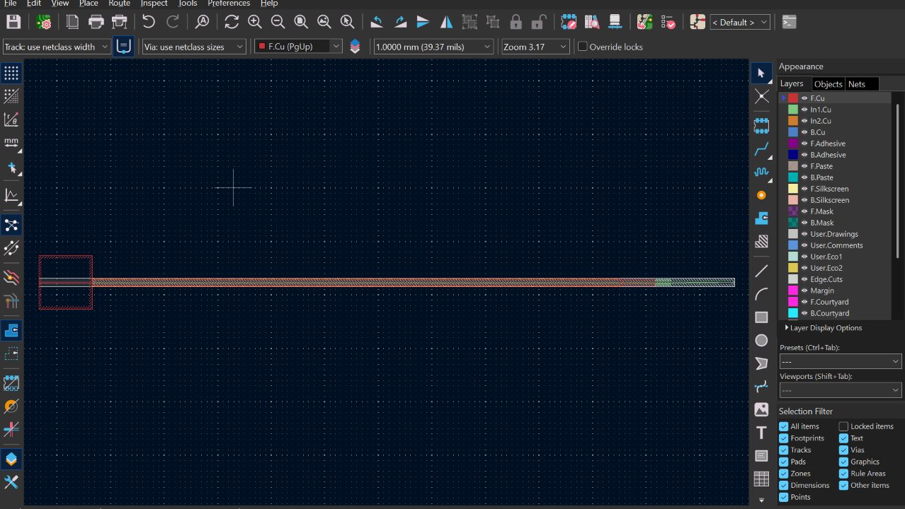
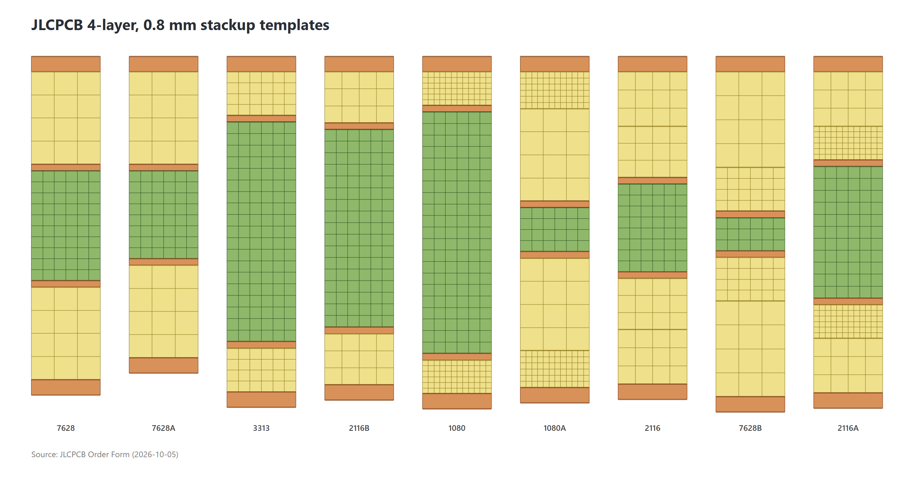
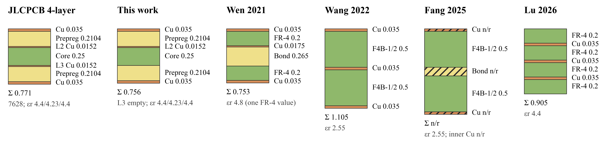
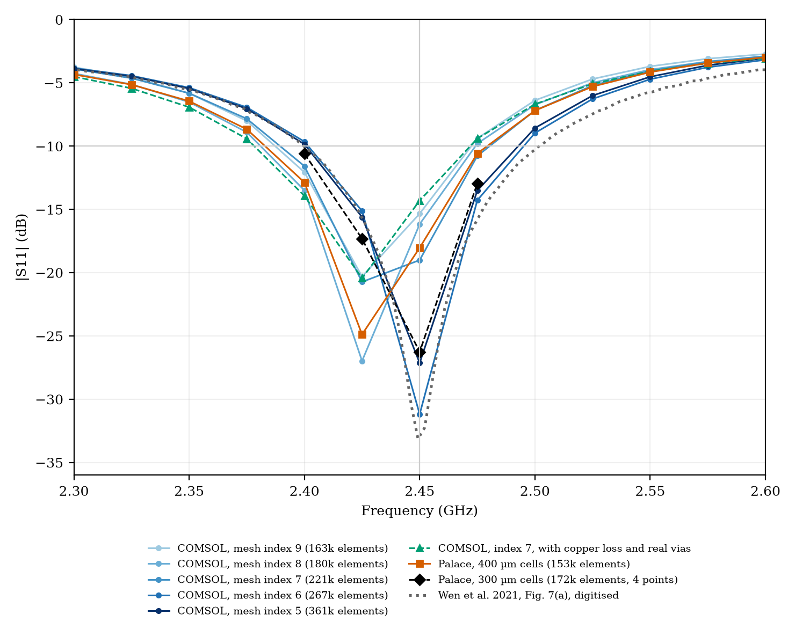

# microwave-ablation-antenna
Planar Microwave Ablation Antenna

## Antenna layout (KiCad)

Planar antenna in the KiCad PCB editor.

## JLCPCB 4-layer, 0.8 mm stackup templates

Nominal stackups listed on the JLCPCB order form (FR-4, 4 layers, 0.8 mm, 1 oz outer / 0.5 oz inner), drawn at one common scale. Per-template tables are in [`pcb_stackup/jlcpcb_4layer_0p8mm/`](pcb_stackup/jlcpcb_4layer_0p8mm/).

## Stackup comparison

Layer stacks of the JLCPCB 4-layer order (JLC04081H-7628), this work (the same order with L3 left empty, which JLCPCB etches away and fills with resin), and four published planar ablation antennas, drawn at one thickness scale in mm. n/r: not reported in the paper.

Vector version: [`pcb_stackup/stackup_comparison.pdf`](pcb_stackup/stackup_comparison.pdf).

## S11 simulation, Wen 2021 baseline

Status: provisional. This is the reference the JLCPCB-stack simulations will be compared with; the JLCPCB stack-up itself has not been simulated yet.

|S11| of the planar SICL helical-dipole antenna of Wen et al. (IEEE Antennas and Wireless Propagation Letters 20(5), 2021) in liver, simulated with COMSOL 6.1 and Palace 0.18.1. Materials and stack are the paper's (FR-4 with a relative permittivity of 4.8 and loss tangent 0.02, liver 43.2 and 1.69 S/m), 50 ohm lumped port, 0.025 GHz frequency steps, the same geometry in every curve. The helix follows Fig. 4b of the paper (14 via pairs per row, last bar of each layer free). That geometry has about 56 mm of arm length, more than the 49.4 mm stated in the paper's text; the text-based geometry (12 via steps) resonated about 5% too high (2.56 to 2.59 GHz) on COMSOL mesh indices 7 to 4.

*Fig. 1. Simulated |S11| of the Wen 2021 antenna in liver: COMSOL at five mesh indices, COMSOL with copper loss and real vias, Palace at two cell sizes, and the digitised curve of Wen et al. 2021, Fig. 7(a) (pixel-limited, extraction uncertainty not estimated).*

What the curves show:

- COMSOL dip frequency: 2.426 to 2.434 GHz on the three coarsest meshes, 2.4497 GHz at index 6 and 2.4490 GHz at index 5, a change of 0.03% between the two finest meshes (fit uncertainty a few MHz on this grid). The paper's dip is at 2.45 GHz.
- Dip depth is not converged: -31.2 dB at index 6 and -27.2 dB at index 5; the paper shows about -33 dB.
- Palace at 300 micrometre cells: dip 2.4475 GHz, -26.4 dB (400 micrometres: 2.4284 GHz, -25.1 dB), 1.5 MHz from COMSOL index 5. Only four frequencies were solved at 300 micrometres.
- Copper loss and real vias (index 7 only) reduce the match at 2.45 GHz from -19.0 dB to -14.3 dB; this model has not been run on a fine mesh.
- The agreement between COMSOL and Palace is consistency between two finite-element codes on one geometry, not independent validation. No measurement of this antenna is included.

**Table I. Mesh and cost of each curve**

| Curve | Solver and mesh setting | Elements | Unknowns | Effective element size (relative to COMSOL index 5) | Sweep points | Run time | Peak memory |
|---|---|---|---|---|---|---|---|
| COMSOL index 9 | COMSOL 6.1, Physics-Controlled Mesh, index 9 | 163,205 | not recorded | 1.30 | 13 | 536 s for the sweep | not logged |
| COMSOL index 8 | COMSOL 6.1, Physics-Controlled Mesh, index 8 | 180,447 | not recorded | 1.26 | 13 | 533 s for the sweep | not logged |
| COMSOL index 7 | COMSOL 6.1, Physics-Controlled Mesh, index 7 | 221,979 | not recorded | 1.18 | 13 | 585 s for the sweep | not logged |
| COMSOL index 6 | COMSOL 6.1, Physics-Controlled Mesh, index 6 | 267,299 | not recorded | 1.11 | 13 | 629 s for the sweep | not logged |
| COMSOL index 5 | COMSOL 6.1, Physics-Controlled Mesh, index 5 | 361,970 | not recorded | 1.00 | 13 | 890 s for the sweep | not logged |
| COMSOL index 7, copper loss and real vias | same, copper as thickness-aware boundary, 90 via cylinders | 232,555 | not recorded | 1.16 | 13 | 593 s for the sweep | not logged |
| Palace 400 µm | Palace 0.18.1, order 2, refined cell size 400 µm | 153,782 | 1,101,132 | n/a | 13 | 98 min for the sweep (6 min per point), 3 MPI ranks | 3.9 GB in the largest rank; total not logged |
| Palace 300 µm | Palace 0.18.1, order 2, refined cell size 300 µm, GMRES restart 50 | 171,567 | 1,228,090 | 0.96 (relative to Palace 400 µm) | 4 | about 11.5 min per point, one point per process | about 9.6 GB used by WSL, up to 10.9 GB at the end of a solve |

Hardware: laptop with a Ryzen 5 7530U (6 cores) and 13.9 GB RAM; Palace ran in WSL with an 11 GB limit and 4 GB swap. COMSOL 6.1 used 6 cores. Palace's linear solver: GMRES, tolerance 1e-6, p-multigrid with a complex coarse solve (SuperLU). COMSOL's: GMRES with a geometric multigrid preconditioner (default). The Palace element counts are those of the solver, which adds interface elements to the 152,587 and 170,117 tetrahedra in the mesh files. Effective element size is (elements)^(-1/3) relative to the reference mesh; the cell-size setting of Palace changes it by only about 3% per step because the thin layers and vias limit the mesh.
