## A Low-Cost Substrate-Integrated Coaxial Microwave Ablation Antenna, Designed for Commodity PCB Fabrication

<p align="center">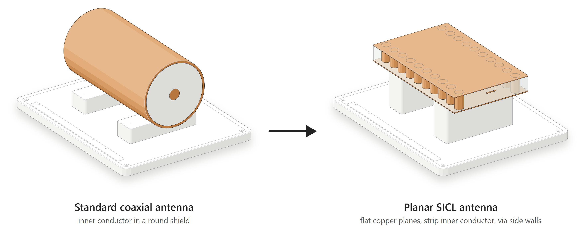</p>
<p align="center"><em>Figure 1: A coaxial ablation antenna (left) rebuilt as a printed circuit board (right). The round shield opens into two copper planes, the inner conductor becomes a strip, and two rows of vias close the sides.</em></p>

> **Status (2026-10-19):** simulation stage. Every result below is a COMSOL 6.1 simulation. No board has been fabricated or measured yet; those sections are marked *not yet verified* and will be filled in as the work happens.

<a name="toc"></a>
# Table of Contents

1. [Author](#author)
2. [Overview](#overview)
3. [Specifications](#specs)
    - [Achieved in simulation](#specs_achieved)
    - [Not yet verified](#specs_open)
4. [The Antenna](#antenna)
    - [Problem Statement](#problem)
    - [Published SICL Ablation Antennas](#published)
    - [The Board in 3D](#board3d)
    - [KiCad Layout](#kicad)
5. [What a Commodity Fab Gives You](#fab)
    - [JLCPCB 4-Layer 0.8 mm Stack-Ups](#stackups)
    - [Stack-Up Comparison with Published Antennas](#stackup_cmp)
    - [Board Cost](#cost)
6. [Simulation Setup](#setup)
7. [Reproducing Wen et al. 2021](#reproduce)
    - [S11 against the Paper](#reproduce_s11)
    - [Mesh and Cost of Each Curve](#reproduce_table)
8. [Mesh Convergence](#mesh)
    - [What a Mesh Index Is](#mesh_index)
    - [The Mesh at Each Index](#mesh_each)
    - [Does the Answer Settle?](#mesh_settle)
9. [Moving to JLCPCB's Stack](#jlcpcb)
    - [Same Layout, JLCPCB's Stack](#jlc_as_drawn)
    - [Retuning the Layout](#retune)
    - [Inner-Strip Width](#strip)
10. [Permittivity Tolerance](#tolerance)
11. [Impedance along the Line](#impedance)
12. [Repository Structure](#repo)
13. [How to Rebuild](#rebuild)
14. [Next Steps](#next)
15. [References](#ref)
16. [Licence](#licence)

---

<a name="author"></a>
## 1. Author

- Benedictus Josh Christian, Department of Biomedical Engineering, Institut Teknologi Sepuluh Nopember (ITS), Surabaya, Indonesia.

[Return to top](#toc)

---

<a name="overview"></a>
## 2. Overview

Microwave ablation treats liver tumours by heating them through a thin antenna inserted into the tissue at 2.45 GHz. Most ablation antennas are built around a coaxial cable. A **substrate-integrated coaxial line (SICL)** is the same coaxial line made as a printed circuit board, so the whole antenna can come from a PCB process.

This repository designs such an antenna for an **ordinary commodity PCB order** (JLCPCB, 4 layers, 0.8 mm) instead of a specialised laboratory process.

### Contributions

- **A commodity-fab build.** The design uses only standard features of a JLCPCB 4-layer order: copper planes, an inner copper layer, drilled and plated vias, and the vendor's own laminate. None of the nine fabricated SICL ablation antennas in [Figure 3](#published) names a commodity service.
- **Tolerance-aware design.** JLCPCB states its laminate permittivity without a frequency or a tolerance. Over the plausible range (3.9 to 4.4) the antenna's resonance moves 124 MHz, more than its whole −10 dB band (about 95 MHz). The design has to survive that spread, not just match one nominal value ([Section 10](#tolerance)).
- **A real cost figure.** One JLCPCB quote: 4-layer 0.8 mm board, $13.20 for 5 ($2.64 each) or $46.10 for 100 ($0.46 each), board only ([Section 5](#cost)).

The starting point is the SICL helical-dipole antenna of Wen et al. (2021), reproduced in simulation first ([Section 7](#reproduce)).

[Return to top](#toc)

---

<a name="specs"></a>
## 3. Specifications

The design goal: |S11| below −10 dB at 2.45 GHz in liver, on the JLCPCB stack, across the laminate's plausible permittivity range.

<a name="specs_achieved"></a>
### 3.1 Achieved in simulation

COMSOL 6.1, liver (εr 43.2, σ 1.69 S/m), 50 Ω lumped port, 1 W incident, FEP sleeve 0.35 mm, Physics-Controlled Mesh index 6, one mesh per case.

| Quantity | Value | Configuration |
|---|---|---|
| Wen 2021 reproduced: dip | 2.4497 GHz, −31.2 dB (paper: 2.45 GHz, about −33 dB) | Wen stack (FR-4, εr 4.8) |
| Board cross-section | 3.7 mm × 0.77 mm (SICL), 3.4 mm wide at the helix | JLCPCB stack |
| Retuned layout: \|S11\| at 2.45 GHz | **−18.4 dB** | JLCPCB nominal stack (4.4 / 4.23 / 4.4), L4 8.0 mm, L2 14.5 mm, L3 72.5 mm |
| Retuned layout: −10 dB band | 2.414 to 2.511 GHz (98 MHz) | same |
| Retuned layout: \|S11\| at 2.45 GHz, permittivity 4.4 in all layers | −24.7 dB | same layout |
| SICL characteristic impedance | about 29.6 Ω (±10%) | JLCPCB stack, L4 8.0 mm, L2 12.5 mm, 2.45 GHz |

<a name="specs_open"></a>
### 3.2 Not yet verified

Listed rather than left out:

| Specification | Status |
|---|---|
| \|S11\| < −10 dB at 2.45 GHz at permittivity 3.9 | **Fails in simulation** (−4.25 dB, 2.45 GHz sits 80 MHz below the band). The criterion holds from about 4.1 up, by interpolation, not a run |
| Measured S11 of a fabricated board | Board not ordered yet |
| Ablation-zone shape and heating | Not simulated (no thermal model yet) |
| Mesh convergence of the JLCPCB runs | One mesh (index 6) only |
| Copper loss and real vias on the JLCPCB stack | Not run; on the Wen stack they reduce the match at 2.45 GHz from −19.0 to −14.3 dB (index 7) |

[Return to top](#toc)

---

<a name="antenna"></a>
## 4. The Antenna

<a name="problem"></a>
### 4.1 Problem Statement

<p align="center">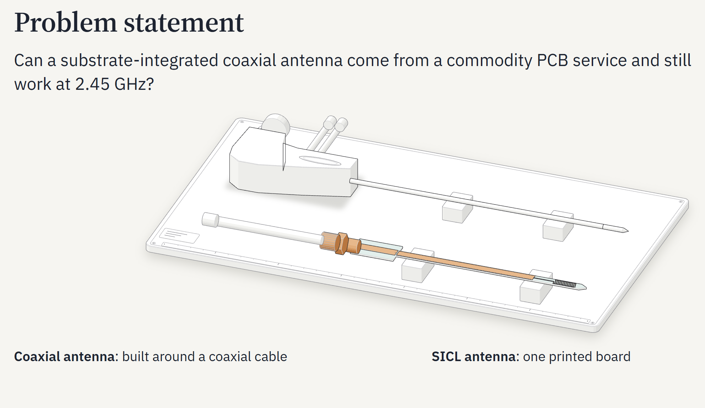</p>
<p align="center"><em>Figure 2: A coaxial ablation antenna is built around a coaxial cable; a SICL antenna is one printed board.</em></p>

<a name="published"></a>
### 4.2 Published SICL Ablation Antennas

<p align="center">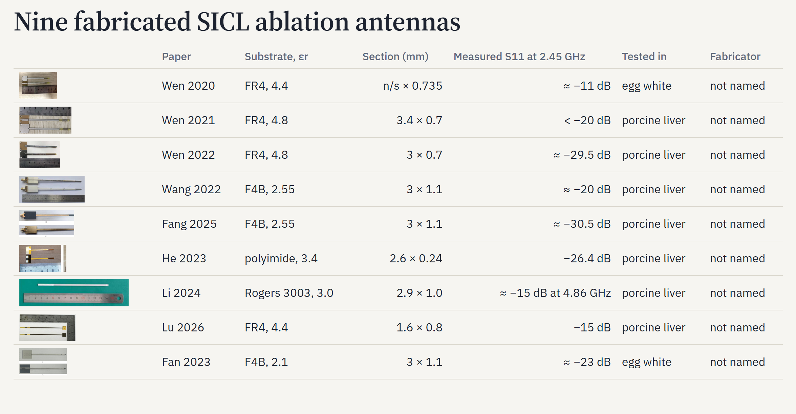</p>
<p align="center"><em>Figure 3: Nine fabricated SICL and planar ablation antennas: substrate, cross-section, measured S11 and test medium, as reported by each paper. None names the company that made the board.</em></p>

<a name="board3d"></a>
### 4.3 The Board in 3D

<p align="center">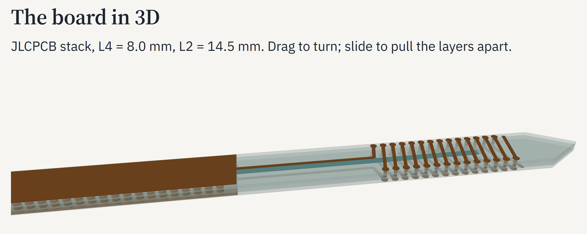</p>
<p align="center"><em>Figure 4: The antenna on the JLCPCB stack (L4 = 8.0 mm, L2 = 14.5 mm), drawn from the same geometry code as the simulation model. Left: the feed and the SICL; right: the helical radiator and the tip.</em></p>

<a name="kicad"></a>
### 4.4 KiCad Layout

<p align="center"></p>
<p align="center"><em>Figure 5: The antenna in the KiCad PCB editor. The KiCad project and its Gerber and drill files are in <code>kicad/wen2021_gate/</code> (Wen 2021 geometry; the retuned JLCPCB layout is not frozen yet).</em></p>

[Return to top](#toc)

---

<a name="fab"></a>
## 5. What a Commodity Fab Gives You

<a name="stackups"></a>
### 5.1 JLCPCB 4-Layer 0.8 mm Stack-Ups

<p align="center">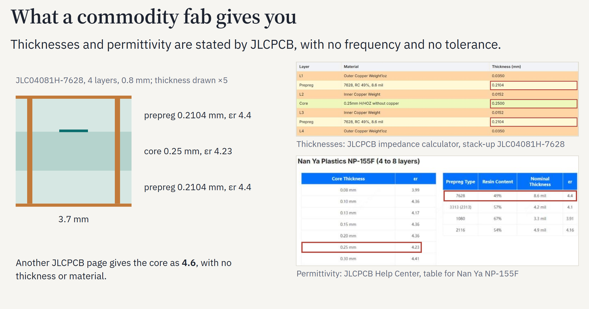</p>
<p align="center"><em>Figure 6: JLCPCB states the thicknesses and permittivities of stack-up JLC04081H-7628 (prepreg 0.2104 mm, εr 4.4; core 0.25 mm, εr 4.23), with no frequency and no tolerance. Another JLCPCB page gives the core as 4.6.</em></p>

<p align="center"></p>
<p align="center"><em>Figure 7: All JLCPCB 4-layer 0.8 mm stack-up templates on the order form (FR-4, 1 oz outer, 0.5 oz inner), at one scale. Per-template tables: <code>pcb_stackup/jlcpcb_4layer_0p8mm/</code>.</em></p>

<a name="stackup_cmp"></a>
### 5.2 Stack-Up Comparison with Published Antennas

<p align="center"></p>
<p align="center"><em>Figure 8: The JLCPCB order (JLC04081H-7628), this work (the same order with L3 left empty, which JLCPCB etches away and fills with resin), and four published planar ablation antennas, at one thickness scale in mm. n/r: not reported. Vector version: <code>pcb_stackup/stackup_comparison.pdf</code>.</em></p>

<a name="cost"></a>
### 5.3 Board Cost

<p align="center">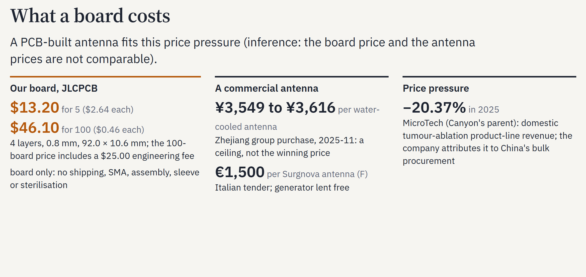</p>
<p align="center"><em>Figure 9: The JLCPCB board price against commercial antenna prices. The board price excludes shipping, the SMA connector, assembly, the sleeve and sterilisation, so the two are not directly comparable.</em></p>

[Return to top](#toc)

---

<a name="setup"></a>
## 6. Simulation Setup

<p align="center">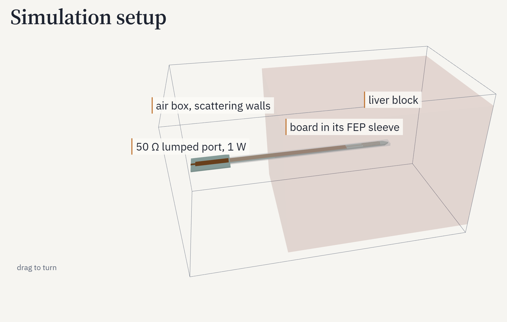</p>
<p align="center"><em>Figure 10: The COMSOL model: an air box with scattering walls, a liver block (εr 43.2, σ 1.69 S/m) starting 20 mm after the feed paddle, the board inside a 0.35 mm FEP sleeve, and a 50 Ω lumped port driven with 1 W.</em></p>

- Solver: COMSOL Multiphysics 6.1, RF Module, frequency domain, Physics-Controlled Mesh (no manual mesh-size nodes).
- Copper: zero-thickness perfect conductor (idealised model); a second model adds copper loss as a transition boundary and real via cylinders.
- Frequencies: 2.30 to 2.60 GHz in 25 MHz steps unless stated.
- Geometry: built from one parameter file, `antenna/params.py`, which lists the source of every dimension (paper table, paper figure, or an assumption).

[Return to top](#toc)

---

<a name="reproduce"></a>
## 7. Reproducing Wen et al. 2021

<a name="reproduce_s11"></a>
### 7.1 S11 against the Paper

<p align="center">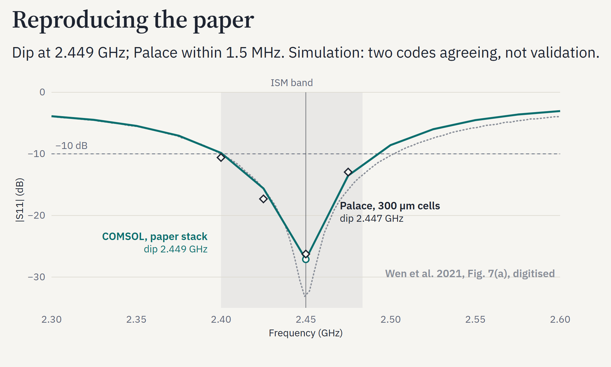</p>
<p align="center"><em>Figure 11: Simulated |S11| of the Wen 2021 antenna on the paper's stack (FR-4, εr 4.8): COMSOL dip at 2.449 GHz; Palace (300 µm cells) within 1.5 MHz. Grey: the paper's digitised Fig. 7(a). Two codes agreeing is consistency, not validation.</em></p>

<p align="center"></p>
<p align="center"><em>Figure 12: The same comparison at every COMSOL mesh index, with copper loss and real vias (index 7), and Palace at two cell sizes.</em></p>

- COMSOL dip: 2.426 to 2.434 GHz on the three coarsest meshes, 2.4497 GHz at index 6, 2.4490 GHz at index 5.
- Dip depth is not converged: −31.2 dB at index 6, −27.2 dB at index 5 (paper: about −33 dB).
- The helix follows the paper's Fig. 4b (14 via pairs per row, the last bar of each layer free), about 56 mm of arm. The text's 49.4 mm arm (12 via steps) resonated about 5% too high.

<a name="reproduce_table"></a>
### 7.2 Mesh and Cost of Each Curve

The full table (elements, unknowns, run time, memory per curve) is in [`simulation/mesh_and_cost_table.md`](simulation/mesh_and_cost_table.md). Hardware: a laptop with a Ryzen 5 7530U (6 cores) and 13.9 GB RAM.

[Return to top](#toc)

---

<a name="mesh"></a>
## 8. Mesh Convergence

<a name="mesh_index"></a>
### 8.1 What a Mesh Index Is

<p align="center">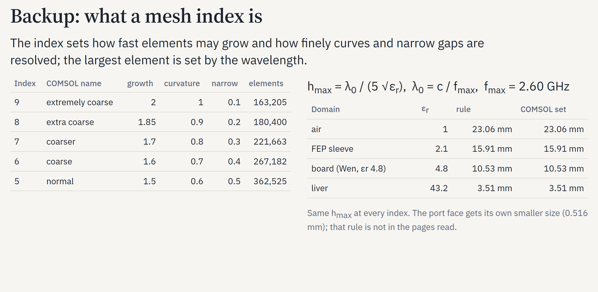</p>
<p align="center"><em>Figure 13: COMSOL's Physics-Controlled Mesh index sets how fast elements may grow and how finely curves and narrow gaps are resolved; the largest element is set by the wavelength in each material.</em></p>

<a name="mesh_each"></a>
### 8.2 The Mesh at Each Index

<p align="center">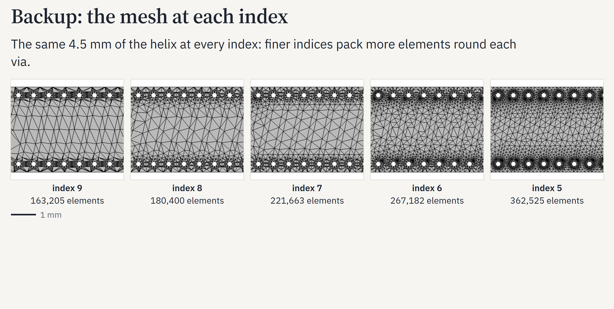</p>
<p align="center"><em>Figure 14: The same 4.5 mm of the helix at indices 9 to 5: finer indices pack more elements around each via (163,205 to 362,525 elements in the whole model).</em></p>

<a name="mesh_settle"></a>
### 8.3 Does the Answer Settle?

<p align="center">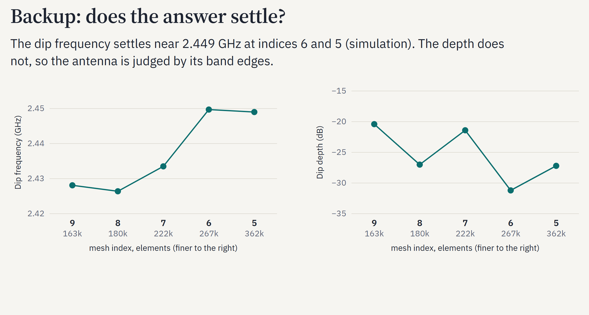</p>
<p align="center"><em>Figure 15: The dip frequency settles near 2.449 GHz at indices 6 and 5; the dip depth does not, so the antenna is judged by its band edges rather than its depth.</em></p>

[Return to top](#toc)

---

<a name="jlcpcb"></a>
## 9. Moving to JLCPCB's Stack

<a name="jlc_as_drawn"></a>
### 9.1 Same Layout, JLCPCB's Stack

<p align="center">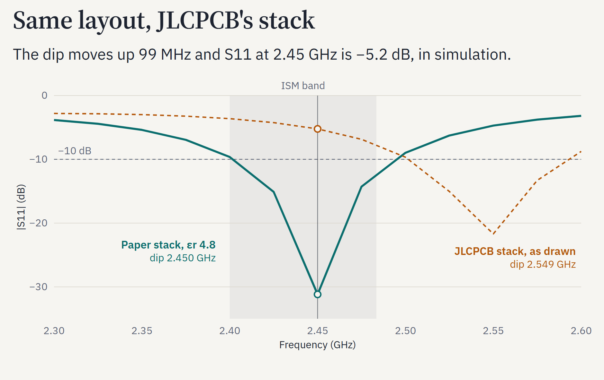</p>
<p align="center"><em>Figure 16: Wen's layout on JLCPCB's stack: the dip moves up 99 MHz to 2.549 GHz and |S11| at 2.45 GHz is −5.2 dB.</em></p>

<a name="retune"></a>
### 9.2 Retuning the Layout

<p align="center">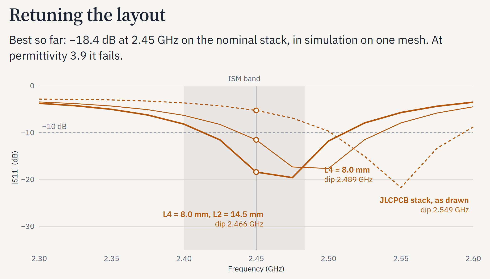</p>
<p align="center"><em>Figure 17: Lengthening the straight arm L4 and the wide feed pad L2 brings the dip back: −18.4 dB at 2.45 GHz with L4 = 8.0 mm, L2 = 14.5 mm (nominal stack, index 6).</em></p>

| Layout (JLCPCB nominal stack, index 6) | Dip (GHz) | Depth (dB) | \|S11\| at 2.45 GHz (dB) | −10 dB band (GHz) |
|---|---|---|---|---|
| As drawn (L4 6.0, L2 12.5, L3 70.5) | 2.5485 | −21.7 | −5.23 | 2.5015 to 2.5932 |
| L4 7.0, L3 71.5 | 2.5221 | −22.3 | −7.64 | 2.4696 to 2.5676 |
| L4 8.0, L3 72.5 | 2.4887 | −18.3 | −11.52 | 2.4384 to 2.5353 |
| L4 9.0, L3 73.5 | 2.4731 | −13.4 | −11.56 | 2.4373 to 2.5077 |
| L4 8.0, L3 72.5, L2 13.5 | 2.4753 | −21.3 | −14.25 | 2.4270 to 2.5223 |
| **L4 8.0, L3 72.5, L2 14.5 (retuned)** | **2.4658** | **−20.2** | **−18.40** | **2.4136 to 2.5114** |

L3 grows with L4 because the helix end meets the tip wedge. L4 alone stops helping near 8 mm.

<a name="strip"></a>
### 9.3 Inner-Strip Width

Widening the inner strip (inside the 2.8 mm via fence, so the board does not get bigger) widens the band but pulls the dip down. Retuned layout, nominal stack, index 6, 2.30 to 2.60 GHz:

| Inner strip (mm) | Dip (GHz) | Depth (dB) | \|S11\| at 2.45 GHz (dB) | −10 dB band (GHz) | Width (MHz) |
|---|---|---|---|---|---|
| 0.5 | 2.4658 | −20.2 | −18.40 | 2.4136 to 2.5114 | 98 |
| 0.8 | 2.4224 | −19.2 | −14.05 | 2.3615 to 2.4741 | 113 |
| 1.1 | 2.3740 | −15.6 | −8.15 | 2.3064 to 2.4308 | 124 |

The strip is also the short dipole arm beyond the line, so the shift mixes a lower line impedance with a wider arm. A 1.1 mm strip needs the layout retuned upward before it is useful.

[Return to top](#toc)

---

<a name="tolerance"></a>
## 10. Permittivity Tolerance

<p align="center">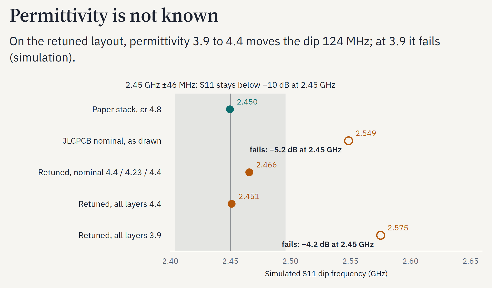</p>
<p align="center"><em>Figure 18: Simulated dip frequency of each layout and permittivity. On the retuned layout, permittivity 3.9 to 4.4 moves the dip 124 MHz; at 3.9 it fails (−4.2 dB at 2.45 GHz).</em></p>

| Retuned layout, permittivity | Dip (GHz) | \|S11\| at 2.45 GHz (dB) | −10 dB band (GHz) |
|---|---|---|---|
| 4.4 in all layers | 2.4511 | −24.66 | 2.4029 to 2.4993 |
| Nominal (4.4 / 4.23 / 4.4) | 2.4658 | −18.40 | 2.4136 to 2.5114 |
| 3.9 in all layers | 2.5752 | −4.25 | 2.5296 to 2.6207 |

The plausible range comes from the laminate maker's datasheet (Nan Ya NP-155F: 4.2 to 4.4 for the laminate, 3.9 to 4.1 for the thin laminate, at 1 GHz). To keep 2.45 GHz inside the band across that range, the band has to be at least about 124 MHz wide with the dip centred.

[Return to top](#toc)

---

<a name="impedance"></a>
## 11. Impedance along the Line

<p align="center">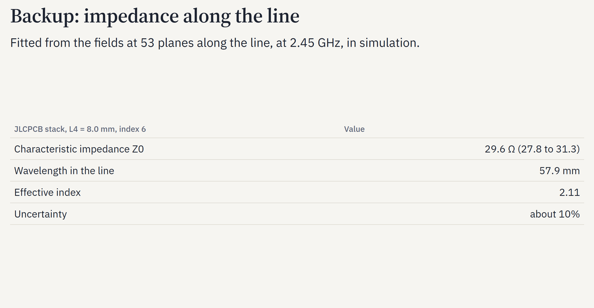</p>
<p align="center"><em>Figure 19: The SICL's characteristic impedance and wavelength, fitted from the voltage and current at 53 planes along the line (JLCPCB stack, L4 = 8.0 mm, index 6, 2.45 GHz).</em></p>

- The voltage is the integral of Ez from the strip to the top plate. The current is the loop integral of H around the strip. A uniform-line fit gives Z0, the wavelength and the impedance at the end of the line (`antenna/analysis/line_fit.py`, tested on synthetic lines).
- Z0 is about 29.6 Ω (27.8 to 31.3 over sub-ranges), with a guided wavelength of 57.9 mm. The load near the line end is about 9 + j10 Ω. Uncertainty is about ±10%.

[Return to top](#toc)

---

<a name="repo"></a>
## 12. Repository Structure

```
antenna/
  params.py            every dimension, with its source; Wen stack and JLCPCB stack
  shapes.py            2D layout (board, copper, vias) from the parameters
  stackup.py           layer stack and loss
  comsol/              build, mesh and solve the COMSOL model; scans and checks
  analysis/            dips, bands, line fit, field sampling, figure scripts
  tests/               fast tests (no COMSOL) and COMSOL tests (test_comsol_*.py)
  results/             S11 sweeps (CSV), impedance and field-check outputs
kicad/
  wen2021_gate/        KiCad project of the Wen 2021 geometry, with fab/ (Gerbers and drill files)
  antenna_pcb_editor.png
pcb_stackup/           JLCPCB stack-up templates and the stack-up comparison
simulation/            Wen 2021 baseline figure and the mesh and cost table
introduction/          the coax-to-SICL figure
figures/               README figures
```

The solved COMSOL models (`.mph`, about 560 MB each) are not included.

[Return to top](#toc)

---

<a name="rebuild"></a>
## 13. How to Rebuild

Requirements: Python 3.10 or later and the packages in `requirements.txt`. The COMSOL scripts also need COMSOL Multiphysics 6.1 (with the RF Module) and its licence; they drive it through the [`mph`](https://github.com/MPh-py/MPh) package.

```bash
pip install -r requirements.txt
cd antenna

# fast tests, no COMSOL needed (test_jlc_stack.py also needs klayout)
python -m pytest -q --ignore-glob="tests/test_comsol_*.py"

# Wen 2021 baseline sweep: mesh index 6, 2.30 to 2.60 GHz in 25 MHz steps
python comsol/run_comsol.py 6 2.30e9 2.60e9 2.5e7 sweep_i6

# retuned layout on the JLCPCB stack (one case per ';')
LIVER_GRID=2.30,2.60,0.025 LIVER_BASE=JLC python comsol/liver_scan.py retuned_i6 "L4=8.0+L3=72.5+L2=14.5" 6 set

# summary table of every scan in results/
python analysis/scan_dips.py
```

Each solve takes about 10 to 20 minutes on a 6-core laptop. The CSV files in `antenna/results/` hold every sweep behind the figures, so the tables can be re-derived without COMSOL.

[Return to top](#toc)

---

<a name="next"></a>
## 14. Next Steps

1. Widen the band to at least about 124 MHz with the dip centred at 2.45 GHz (inner-strip width, arm lengths), so the design survives permittivity 3.9 to 4.4.
2. Check where the power is absorbed along the antenna at 2.45 GHz (tip against shaft).
3. Freeze the layout, export Gerbers for the JLCPCB stack, and order the boards.
4. Measure S11 with a vector network analyser in saline and in tissue phantoms.

[Return to top](#toc)

---

<a name="ref"></a>
## 15. References

1. Z. Wen, X. Q. Lin, C. Li, J. Guo and Y. L. Fan, "A Microwave Ablation Antenna Based on Substrate-Integrated Coaxial Line," *IEEE Antennas and Wireless Propagation Letters*, vol. 20, no. 5, pp. 713–717, 2021, doi: [10.1109/LAWP.2021.3061006](https://doi.org/10.1109/LAWP.2021.3061006).
2. JLCPCB, impedance calculator and stack-up JLC04081H-7628, read 2026-10-05 to 2026-10-13.
3. Nan Ya Plastics, NP-155F laminate datasheet (issued 2025-10-27, read 2026-10-12).
4. The papers in Figure 3, as named there.

[Return to top](#toc)

---

<a name="licence"></a>
## 16. Licence

- Code: MIT ([`LICENSE`](LICENSE)).
- Figures and text: CC BY 4.0 ([`LICENSE-figures`](LICENSE-figures)).
- Digitised data from published papers (`antenna/results/paper_fig7a_*.csv`) belongs to its authors and is included for comparison, with the citation above.
